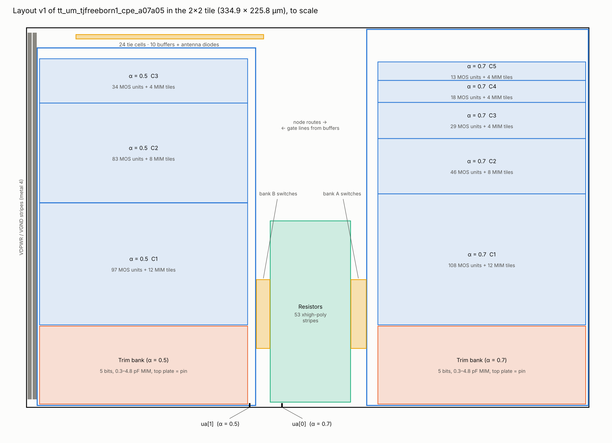
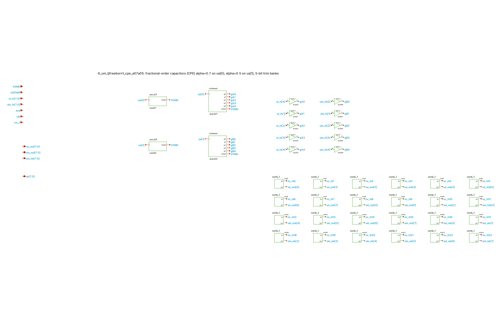

<!---

This file is used to generate your project datasheet. Please fill in the information below and delete any unused
sections.

You can also include images in this folder and reference them in the markdown. Each image must be less than
512 kb in size, and the combined size of all images must be less than 1 MB.
-->

## How it works

This project contains two passive **fractional-order capacitors** (constant-phase elements, CPEs). An ideal CPE has
impedance Z = 1 / ((jω)^α · Cα): its phase stays at −90·α degrees at every frequency, between a resistor (α = 0)
and a capacitor (α = 1).

- `ua[0]`: α = 0.7 element, target phase −63°.
- `ua[1]`: α = 0.5 element, target phase −45°.

Each element is a Morrison–Valsa RC network (parallel series-RC branches plus a parallel resistor) built from
SKY130 xhigh-poly resistors and stacked MOS + MIM capacitors, about 200 pF per network. The network was optimized
together with the Tiny Tapeout analog pin path (series resistance and pin capacitance), so that the pin capacitance
acts as part of the network.

Each element has a **5-bit on-chip trim bank** switched by NMOS transistors. The drawn steps are 0.3 pF (0–9.3 pF); the
extracted layout gives about 0.34 pF steps (0–9.5 pF) because of coupling to the top plate. The code is set
on `ui_in[4:0]` for `ua[0]` and on `uio_in[4:0]` for `ua[1]` (bit 0 = LSB). The bank compensates for the chip-to-chip
spread of the pin capacitance and process corners.

The DC bias applied by the impedance analyzer (0.7–1.5 V) changes the MOS-capacitor values and so tunes Cα by about 8 %.

Post-layout simulated performance (extracted layout, SKY130 models, best trim code per chip, worst of 12 pin-path
models):

| Pin | Phase within ±2.5°: median / 99 % of chips at least / worst chip | Phase within ±3°: median / worst | Band shared by all 828 corner cases (±2.5°) | Fitted α | Cα at 1.0 V: typical ±1σ (range over all corners) |
|---|---|---|---|---|---|
| `ua[0]` α = 0.7 | 4.32 / 4.28 / 3.96 decades | 4.38 / 4.32 decades | 4.12 decades, 126 Hz – 1.68 MHz | 0.713 | 1.66 nF·s^-0.3 ± 1.1 % (1.56 – 1.76) |
| `ua[1]` α = 0.5 | 2.33 / 2.29 / 1.99 decades | 2.38 / 2.34 decades | 2.12 decades, 1.9 kHz – 251 kHz | 0.500 | 30.1 nF·s^-0.5 ± 2.3 % (26.2 – 32.4) |

- **Monte Carlo coverage:** 500 samples, 300 at the typical MOS corner and 50 at each of ss/ff/sf/fs. Each sample has
  per-device mismatch plus global resistor and MIM variation, with 3σ equal to the PDK corners.
- **Why there is a small tail:** the in-band phase ripple peaks at about ±2.2°, close to the ±2.5° limit. In about
  1 % of chips mismatch pushes one ripple peak past 2.5°, which splits the band:
  - α = 0.5: the peak near 170 kHz.
  - α = 0.7: one sample, with a 500 Ω / 4 pF pin.
  - At ±3° no chip shows this.
- **How Cα is defined:** it is fitted over each chip's own ±2.5° band with the nominal 100 Ω / 6.5 pF pin model. Its
  units follow the fitted α. Forcing α to exactly 0.7 raises Cα by about 16 %.
- **Wiring resistance:** results with and without it agree to 0.03 decades.

## How to test

You need an impedance analyzer with DC bias (designed around a Keysight E4990A, 20 Hz – 10 MHz; DC bias is part of
its standard specification).

**Connection (four-terminal pair, kept intact to the chip).** Bring the analyzer's Hc/Hp/Lp/Lc to the carrier with
either:
- Keysight four-terminal-pair test leads (16048A, 1 m, DC–30 MHz), with the cable-length setting at 1 m and
  open/short compensation; or
- four identical short BNC cables (same type and length, ideally under about 30 cm), with the adapter/cable setting at
  none (0 m) and **open/short/load** compensation. The load step corrects the phase error that uncharacterized cables
  add. Use a known RC part as the load, measured once directly on the analyzer's front panel.

In both cases, join the four shields at the far end. Join Hc and Hp at the `ua` pin and Lc and Lp at the adjacent GND
pin.

A short adapter, or an interposer between the carrier and the demoboard, works best. It routes `ua[0]` and `ua[1]`
straight to the BNCs and does not pass them down to the demoboard. Kelvin/alligator clip leads (16089 series) are
specified only to 100 kHz. They cannot cover the top of the band, or the trim calibration that depends on it, so use
them only for a rough low-frequency check.

**Validate the setup before measuring the chip.** Measure a second known part (for example 1 MΩ ∥ 10 pF) through the
same connection and compare it with a direct front-panel measurement. The phase should agree within about 0.2° up to
2 MHz.

1. **Prepare the board.** The TT ETR demoboard v3 has a 10 MΩ pull-down to ground on every analog pin. Lift it on
   the two pins used, or measure the carrier without the demoboard. Left in place it sits in parallel with the
   α = 0.7 element (whose own parallel resistor is 18 MΩ) and erases the bottom decade of its band.
2. **Compensate as close to the chip as possible, without the chip.** Do open/short compensation at the demoboard
   analog header with the ASIC carrier removed, or at the carrier pins.
   - **Do not** take the "open" with the project deselected. That subtracts the on-chip bus and pad capacitance
     (about 4 pF), which the design counts as part of its top-end capacitance, and the bands collapse (α = 0.5 to
     about 1–1.8 decades).
   - Uncompensated external capacitance (carrier trace, leads) should stay at or below about 5 pF. The trim can
     absorb about 6 pF; beyond that the best code goes to 0 and the band collapses.
3. Power the board and select this project. Set all of `ui_in[4:0]` and `uio_in[4:0]` low (code 0).
4. **Set the test-signal level before connecting.** The E4990A defaults to 500 mVrms, which is too large. Then apply
   1.0 V DC bias, kept between 0.7 V and 1.5 V. Apply the bias only after the chip is powered and the project is
   selected.
   - DC bias is required: the MOS capacitors need at least about 0.5 V on the pin. With no bias the constant-phase
     band collapses to under one decade.
   - Keep (bias − peak signal) ≥ 0.5 V and (bias + peak signal) ≤ 1.8 V. At 1.0 V bias that allows at most
     0.35 Vrms.
   - **Recommended: a segment sweep,** 300 mVrms below 10 kHz and 100 mVrms above. Below about 1 kHz the α = 0.7
     element is 1–6 MΩ, where the E4990A's guaranteed phase accuracy at 100 mVrms is only ±0.9° (1 kHz) to ±4–5°
     (100 Hz). At 300 mVrms it is ±1.5° at 126 Hz. In simulation the larger signal moves the phase by only 0.04°.
   - At 1.0 V bias and 100 mVrms, the simulated current distortion is 0.3–0.4 % at 1–2 kHz. The impedance changes by
     less than 0.1 % compared with a 10 mVrms signal.
   - Before sweeping all codes, compare the code-0 readings with the checkpoint table below.
5. Calibrate the trim code: measure the phase from 20 Hz to 10 MHz for each code 0–31 and keep the code with the
   widest continuous band within ±2.5° of −90α°. This takes 32 sweeps, about 10 minutes per pin.
   `test/analyze_e4990.py` does this from the 32 exported files and fits α and Cα.
   - The ±2.5° figure is a cliff. The simulated in-band phase ripple is about ±2.2°, so being one code off costs
     0.3–0.4 decades. Analyzer phase accuracy and fixture-compensation residue therefore matter.
   - Report the ±3° band as well.
   - Sanity check: the best code should lie between 1 and 30. Code 0 means too much uncompensated external
     capacitance. Code 31 means less than designed for, for example when the bus capacitance was compensated away.
   - The quicker shortcut of picking the flattest phase over only the top of the band (150 – 600 kHz for α = 0.7,
     50 – 200 kHz for α = 0.5) is not recommended. In simulation it picks a code one to three steps off for about 1 %
     of chips, mostly when the pin resistance is high and the pin capacitance small. That can cut the α = 0.7 band
     to about 2.2 decades.
6. Leave the other analog pin unconnected or idle while measuring. The on-chip crosstalk between `ua[0]` and `ua[1]`
   is −54 dB at 10 MHz; package and board coupling will be larger.
7. Repeat at 0.7 V and 1.5 V bias, recalibrating the code each time, to measure the Cα tuning.

**Checkpoint at code 0 (1.0 V bias), before sweeping all codes.** Expect these readings within a few percent. The
phase near 1 MHz is not yet flat at code 0; the trim fixes that.

| Pin | 100 Hz | 1 kHz | 100 kHz | 1 MHz |
|---|---|---|---|---|
| `ua[0]` (α = 0.7) | 6.9 MΩ ∠−60° | 1.24 MΩ ∠−63° | 50 kΩ ∠−59° | 12 kΩ ∠−48° |
| `ua[1]` (α = 0.5) | 680 kΩ ∠−5° | 477 kΩ ∠−36° | 45 kΩ ∠−36° | 25 kΩ ∠−48° |

Fault signatures:
- `ua[0]` at 100 Hz reads about 4.7 MΩ ∠−37°: a pull-down or other leakage path is still connected.
- Nothing has a flat phase anywhere: there is no DC bias.
- The phase sits near −45° where −63° was expected: wrong pin, or `ui_in` and `uio_in` swapped.
- The best code is 0: too much uncompensated external capacitance. The best code is 31: the on-chip bus capacitance
  was compensated away (open taken with the project deselected).

**Expected measurement result.** A simulated rehearsal fed synthetic E4990A data, at both typical and guaranteed-limit
analyzer accuracy, through this procedure. It used 100 Monte Carlo chips, the extracted TT switch, bus and board,
compensation at the header and a segment sweep:
- α = 0.7: median 4.29–4.33 decades, 95 % of chips above 3.87–3.97.
- α = 0.5: median 2.34 decades, 95 % above 2.31.
- The chosen code is the chip's best code in 86–98 % of cases, and always within one code.

### Safe operating limits

| Quantity | Limit | Why |
|---|---|---|
| Pin voltage, bias + peak signal | ≤ 1.8 V | The MOS capacitors are 1.8 V thin-oxide devices, with the gate on the pin. |
| Pin voltage, bias − peak signal | ≥ 0.5 V for valid data; never below −0.3 V | MOS capacitor bias; forward-biased junctions and ESD diodes. |
| Test signal | 100 mVrms recommended. Maximum peak = the smaller of (1.8 V − bias) and (bias − 0.5 V): 0.35 Vrms at 1.0 V bias, 0.21 Vrms at 1.5 V, 0.14 Vrms at 0.7 V. | Larger signals overstress the 1.8 V devices or forward-bias junctions. For example, 1 Vrms at 1.0 V bias puts 2.4 V on the MOS-capacitor gates and gives 12–15 % distortion at 1 kHz. |
| VDPWR | 1.62 – 1.8 V | The trim switches were checked at 1.62 V. The gates swing fully, and on-resistance runs from about 15 Ω (bit 4) to 243 Ω (bit 0) at tt, 27 °C, or at most 24–400 Ω at ss, 125 °C. |
| Order | Power the chip and select the project before applying bias; remove the bias first. | The trim-switch gates are undefined while the chip is unpowered. |

## External hardware

An impedance analyzer with DC bias, such as the Keysight E4990A, 20 Hz – 10 MHz. Connect it with either Keysight
four-terminal-pair test leads or four matched short BNC cables (the latter with open/short/load compensation), via a
short adapter or interposer at the carrier that keeps the analog pins off the demoboard pull-downs. Do not use Kelvin
or alligator clip leads, which are specified only to 100 kHz.
