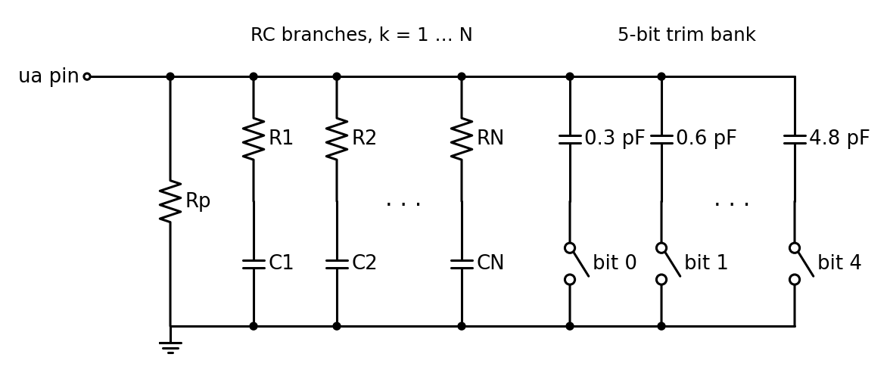
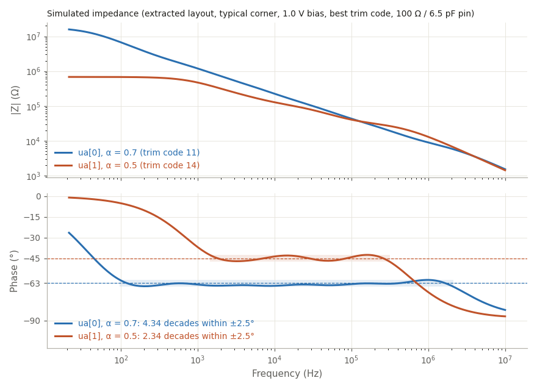

<!---

This file is used to generate your project datasheet. Please fill in the information below and delete any unused
sections.

You can also include images in this folder and reference them in the markdown. Each image must be less than
512 kb in size, and the combined size of all images must be less than 1 MB.
-->

## How it works

This project contains two passive approximations of **fractional-order capacitors** (constant-phase elements, CPEs).
A capacitor's phase is −90° and a resistor's is 0°. A CPE sits in between, at −90·α degrees, and keeps that phase
over a wide range of frequencies. CPEs are used to build fractional-order filters, oscillators and controllers, and
to model electrode, battery and biological-tissue impedance.

- `ua[0]`: α = 0.7 element, target phase −63°.
- `ua[1]`: α = 0.5 element, target phase −45°.

`ua[0]` and `ua[1]` are the project's analog pins. The physical chip pin each one reaches depends on where the
project sits on the shuttle; check this project's page on tinytapeout.com for the pin numbers on your chip.

### Terms used

- **α (order):** sets the phase, −90·α degrees. α = 1 is an ordinary capacitor, α = 0 a resistor.
- **Cα:** the "size" of the element, like capacitance for a capacitor. The ideal impedance is
  Z = 1 / ((jω)^α^ · Cα), so |Z| = 1 / (ω^α^ · Cα). Its unit, nF·s^(α−1)^, is unusual; in practice, at 10 kHz `ua[0]`
  measures about 260 kΩ and `ua[1]` about 130 kΩ.
- **Constant-phase band:** the frequency range over which the measured phase stays within ±2.5° of −90·α degrees.
  This is the main performance figure. An RC network can only hold the phase over a limited band.
- **Decades:** the width of that band on a log scale, log10(f_high / f_low). Three decades is a 1000:1 range, for
  example 1 kHz to 1 MHz.
- **Trim code:** a 5-bit number (0–31) on the project's input pins that adds a small capacitance to the element.
  It is chosen once per chip during measurement (test step 6) to make the band as wide as possible.
- **Pin path:** everything between the on-chip network and the package pin: the Tiny Tapeout analog switch, the
  on-chip analog bus and the pad. It adds series resistance (35–500 Ω) and capacitance to ground (about 4 pF on chip,
  4–9 pF including the board). This design treats the pin capacitance as part of the network.
- **Process corners:** the extremes of manufacturing variation. tt is typical; ss and ff are slow and fast
  transistors; sf and fs are mixed.
- **Monte Carlo:** simulating many randomly varied chips. **Mismatch** is the random difference between nominally
  identical devices on the same chip; **σ** is the standard deviation.

### Design

Each element is a Morrison–Valsa network [1, 2]: a resistor Rp in parallel with several series resistor–capacitor
branches, with values spaced so that their combined phase ripples only slightly around the target. It is built from
SKY130 high-resistance polysilicon resistors and MOS plus MIM capacitors, about 200 pF per element.

Each element also has a **5-bit trim bank**: five binary-weighted capacitors, each switched to ground by an NMOS
transistor. The drawn steps are 0.3 pF (0–9.3 pF); in the extracted layout extra parasitic capacitance makes them
about 0.34 pF (0–9.5 pF). The code is set on `ui_in[4:0]` for `ua[0]` and on `uio_in[4:0]` for `ua[1]` (bit 0 =
least significant). The trim makes up for chip-to-chip differences in the pin capacitance and the process.

The MOS capacitors only work with a DC bias of at least about 0.5 V on the pin, which the impedance analyzer
supplies. Changing the bias between 0.7 and 1.5 V changes the MOS-capacitor values and so tunes Cα by about 8 %.

**Simulated performance** (extracted layout, best trim code for each chip, worst case over 12 pin-path models):

| Metric | `ua[0]`, α = 0.7 | `ua[1]`, α = 0.5 |
|---|---|---|
| Band within ±2.5°: median chip | 4.32 decades | 2.33 decades |
| Band within ±2.5°: 99 % of chips at least | 4.28 decades | 2.29 decades |
| Band within ±2.5°: worst chip | 3.96 decades | 1.99 decades |
| Band within ±3°: median / worst chip | 4.38 / 4.32 decades | 2.38 / 2.34 decades |
| Band common to every simulated case (±2.5°) | 4.12 decades, 126 Hz – 1.68 MHz | 2.12 decades, 1.9 – 251 kHz |
| Fitted α | 0.713 | 0.500 |
| Cα at 1.0 V bias, typical ± 1σ | 1.66 nF·s^−0.3^ ± 1.1 % | 30.1 nF·s^−0.5^ ± 2.3 % |
| Cα, range over all corners | 1.56 – 1.76 nF·s^−0.3^ | 26.2 – 32.4 nF·s^−0.5^ |

Section "Verification details" below explains how these were simulated.

### Circuit

Each pin connects to its own network: a parallel resistor Rp, and N branches of a resistor Rk in series with a
capacitor Ck, all from the pin to ground. The trim bank is in parallel with them. N = 5 for α = 0.7 (`ua[0]`) and
N = 3 for α = 0.5 (`ua[1]`). Trim bit k is set by `ui_in[k]` for `ua[0]` and by `uio_in[k]` for `ua[1]`; a set bit
closes that switch and adds 0.3 pF × 2^k^.

**Element values** (as laid out). Each Ck is a number of 10 × 10 µm MOS capacitor units (about 0.76 pF each at 1.0 V
bias) plus a MIM capacitor in parallel.

| `ua[0]`, α = 0.7 | Rk | Ck (MOS units + MIM) |
|---|---|---|
| R1, C1 | 3.94 MΩ | 100.2 pF (108 units + 18.2 pF MIM) |
| R2, C2 | 1.25 MΩ | 42.4 pF (46 units + 7.5 pF MIM) |
| R3, C3 | 331 kΩ | 26.9 pF (29 units + 4.9 pF MIM) |
| R4, C4 | 85.8 kΩ | 16.5 pF (18 units + 2.9 pF MIM) |
| R5, C5 | 15.5 kΩ | 12.3 pF (13 units + 2.4 pF MIM) |
| Rp | 18.0 MΩ | — |

| `ua[1]`, α = 0.5 | Rk | Ck (MOS units + MIM) |
|---|---|---|
| R1, C1 | 591 kΩ | 90.5 pF (97 units + 16.9 pF MIM) |
| R2, C2 | 222 kΩ | 76.8 pF (83 units + 13.8 pF MIM) |
| R3, C3 | 51.0 kΩ | 31.9 pF (34 units + 6.1 pF MIM) |
| Rp | 682 kΩ | — |

- **Devices (SKY130 cells):**
  - Resistors: `sky130_fd_pr__res_xhigh_po_0p35` (0.35 µm wide), R ≈ 5.71 kΩ/µm × L + 0.62 kΩ per segment.
  - MIM capacitors: `sky130_fd_pr__cap_mim_m3_1`.
  - MOS capacitors: `sky130_fd_pr__nfet_01v8`, gate on the branch node, source, drain and body to ground.
  - Trim switches: `sky130_fd_pr__nfet_01v8`.
- **Trim bank:** binary-weighted MIM capacitors (drawn 0.3, 0.6, 1.2, 2.4, 4.8 pF). The pin capacitance (about
  4–9 pF) supplies the rest of the capacitance that sets the upper end of the band.
- **Size:** 2 × 2 tiles, 334.9 × 225.8 µm. The α = 0.5 block is on the left, the α = 0.7 block on the right, and the
  resistor array and trim switches are in the centre.

### Verification details

- **Corner analysis:** 69 combinations of process corner, bias (0.7, 1.0, 1.5 V) and temperature (0–70 °C), each
  with 12 pin-path models (series resistance 35, 100, 300 or 500 Ω × pin capacitance 4, 6.5 or 9 pF): 828 cases per
  element. The "band common to every simulated case" row comes from these.
- **Monte Carlo:** 500 chips, 300 at the typical MOS corner and 50 at each of ss, ff, sf and fs. Each chip has
  device-to-device mismatch plus chip-wide resistor and MIM variation, with 3σ equal to the PDK corners. Each chip
  uses its own best trim code and the worst of the 12 pin-path models.
- **Why a few chips fall short:** the in-band phase ripple peaks at about ±2.2°, close to the ±2.5° limit. In about
  1 % of chips mismatch pushes one ripple peak past 2.5°, which splits the band (for α = 0.5 near 170 kHz; for
  α = 0.7 one chip, with the 500 Ω / 4 pF pin). At ±3° no chip does this.
- **How Cα is fitted:** over each chip's own ±2.5° band, with the nominal 100 Ω / 6.5 pF pin. Its unit follows the
  fitted α. Forcing α to exactly 0.7 raises Cα by about 16 %.
- **Wiring resistance:** results with and without it agree to 0.03 decades.
- Full sign-off records are in the repository's `verification/` folder.

### Known limitations

- **DC bias is required.** The MOS capacitors need at least about 0.5 V on the pin. Without bias neither element is
  a constant-phase element.
- **The design counts on the pin capacitance.** The on-chip bus and pad capacitance plus a few pF outside are part of
  the network. Compensating them away, or adding more than about 6 pF, moves the best trim code past the end of its
  range.
- **The ±2.5° margin is thin.** The in-band ripple is about ±2.2°, so about 1 % of chips lose part of the band at
  ±2.5° (worst simulated: 3.96 and 1.99 decades). None do at ±3°.
- **The trim can't fix one resistor being off relative to the others.** It corrects errors that shift all parts the
  same way: all resistors ±25 %, all MOS capacitors ±20 % and all MIM capacitors ±15 % still pass. The α = 0.5
  network is the more sensitive one: its branch-2 resistor must be within about ±5–10 % of the others. All the
  resistors are the same device type, so only a model error that depends on resistor length could do this; ordinary
  mismatch is about 1 % σ.
- **The analyzer, not the chip, limits the bottom of α = 0.7.** Below about 1 kHz the element is 1–6 MΩ, where the
  E4990A's guaranteed phase accuracy is ±1–5°, depending on signal level. The low band edge (about 100–130 Hz) can
  only be verified to that accuracy.

### References

1. R. Morrison, "RC constant-argument driving-point admittances," *IRE Transactions on Circuit Theory*, vol. 6,
   no. 3, pp. 310–317, 1959.
2. J. Valsa and J. Vlach, "RC models of a constant phase element," *International Journal of Circuit Theory and
   Applications*, vol. 41, no. 1, pp. 59–67, 2013.

## How to test

### Quick start

1. Use an impedance analyzer with DC bias and four-terminal-pair leads, compensated at the carrier with the chip out.
2. Keep the analog pins off the demoboard's 10 MΩ pull-downs.
3. Power the board, select this project, set all of `ui_in[4:0]` and `uio_in[4:0]` low.
4. Set the test signal to 100 mVrms (300 mVrms below 10 kHz), then apply 1.0 V DC bias.
5. Sweep 20 Hz – 10 MHz for each trim code 0–31 and save one file per code.
6. Run `test/analyze_e4990.py` to pick the best code and report the band, α and Cα.

The details follow.

### Measurement terms

- **Four-terminal pair (Hc, Hp, Lp, Lc):** the analyzer's four coaxial connections, high current, high potential,
  low potential and low current. Current is forced on one pair and voltage sensed on the other, so lead resistance
  drops out.
- **Compensation (open / short / load):** the analyzer measures the fixture with nothing connected (open), with a
  short (short) and, optionally, with a known part (load), and removes the fixture's own effect from later readings.
- **DC bias:** a DC voltage the analyzer adds underneath its AC test signal.
- **Segment sweep:** one frequency sweep split into ranges with different settings, here a larger test signal at
  low frequencies.
- **Carrier, demoboard, interposer:** the carrier is the small board that holds the Tiny Tapeout chip; the demoboard
  is the TT ETR demoboard it plugs into; an interposer is a small adapter board fitted between the two.

### Equipment and connection

You need an impedance analyzer with DC bias. This procedure was written for a Keysight E4990A (20 Hz – 10 MHz; DC
bias is part of its standard specification). Bring its Hc/Hp/Lp/Lc to the carrier with either:

- Keysight four-terminal-pair test leads (16048A, 1 m, DC–30 MHz), with the cable-length setting at 1 m and
  open/short compensation; or
- four identical short BNC cables (same type and length, ideally under about 30 cm), with the adapter/cable setting at
  none (0 m) and **open/short/load** compensation. The load step corrects the phase error that uncharacterized cables
  add. Use a known RC part as the load, measured once directly on the analyzer's front panel.

In both cases, join the four shields at the far end. Join Hc and Hp at the `ua` pin and Lc and Lp at the adjacent GND
pin.

A short adapter, or an interposer between the carrier and the demoboard, works best. It routes `ua[0]` and `ua[1]`
straight to the BNCs and does not pass them down to the demoboard. Kelvin/alligator clip leads (16089 series) are
specified only to 100 kHz. They cannot cover the top of the band, or the trim calibration that depends on it, so use
them only for a rough low-frequency check.

**Without an E4990A:** any impedance analyzer or LCR meter with DC bias and four-terminal leads works if it covers
about 50 Hz – 3 MHz for `ua[0]` and 1 – 300 kHz for `ua[1]` with good phase accuracy at 100 kΩ – 10 MΩ. A function
generator (with its DC offset as the bias) driving the pin through a series resistor, read with a two-channel
oscilloscope, gives only a rough check: it works best on `ua[1]` in the mid band, and the probe's input resistance
and capacitance must be corrected for, because they are comparable to the element's impedance. Keep the generator
within the safe operating limits below.

### Procedure

1. **Prepare the board.** The TT ETR demoboard v3 has a 10 MΩ pull-down resistor from every analog pin to ground.
   Remove the resistor for the two pins used (see the demoboard schematic), or measure the carrier without the
   demoboard. Left in place it sits in parallel with the α = 0.7 element (whose own Rp is 18 MΩ) and erases the
   bottom decade of its band.
2. **Compensate as close to the chip as possible, without the chip.** Do open/short compensation (open/short/load if
   you are using short BNC cables) at the demoboard analog header with the ASIC carrier removed, or at the carrier
   pins.
   - **Do not** take the "open" with the chip in place and the project deselected. That subtracts the on-chip bus
     and pad capacitance (about 4 pF), which the design counts as part of the network, and the bands collapse
     (α = 0.5 to about 1–1.8 decades).
   - Uncompensated external capacitance (carrier trace, leads) should stay at or below about 5 pF. The trim can
     absorb about 6 pF; beyond that the best code goes to 0 and the band collapses.
3. **Validate the setup.** Measure a known part (for example 1 MΩ ∥ 10 pF) through the same connection and compare it
   with a direct front-panel measurement. The phase should agree within about 0.2° up to 2 MHz.
4. **Power the board and select this project.** Set all of `ui_in[4:0]` and `uio_in[4:0]` low (code 0).
5. **Set the test signal, then the bias.** Use a segment sweep: 300 mVrms below 10 kHz and 100 mVrms above (the
   E4990A's default of 500 mVrms is too large). Then apply 1.0 V DC bias. Apply the bias only after the chip is
   powered and the project selected. The bias and signal rules are under "Safe operating limits" below.
   - Why 300 mVrms at low frequency: below about 1 kHz the α = 0.7 element is 1–6 MΩ, where the E4990A's guaranteed
     phase accuracy at 100 mVrms is only ±0.9° (1 kHz) to ±4–5° (100 Hz). At 300 mVrms it is ±1.5° at 126 Hz. In
     simulation the larger signal moves the phase by only 0.04°.
   - Before sweeping all codes, compare the code-0 readings with the checkpoint table below.
6. **Find the best trim code.** Measure the phase from 20 Hz to 10 MHz for each code 0–31 and keep the code with the
   widest continuous band within ±2.5° of −90·α degrees. This takes 32 sweeps, about 15–30 minutes per pin.
   - Export each sweep as `code00.csv` … `code31.csv` in one folder, with columns frequency (Hz), |Z| (Ω) and phase
     (degrees); the E4990A's |Z|–θ trace export works as is. Then run
     `python3 test/analyze_e4990.py <folder> --alpha 0.7` (or `--alpha 0.5`). It picks the code, reports the ±2.5°
     and ±3° bands and fits α and Cα. `test/example_data/` has sample input.
   - The ±2.5° limit is a cliff. The simulated in-band ripple is about ±2.2°, so being one code off costs 0.3–0.4
     decades, and analyzer phase accuracy and compensation residue matter. Report the ±3° band as well.
   - Sanity check: the best code should lie between 1 and 30. Code 0 means too much uncompensated external
     capacitance. Code 31 means less than designed for, for example when the bus capacitance was compensated away.
   - Picking the flattest phase over only the top of the band (150 – 600 kHz for α = 0.7, 50 – 200 kHz for α = 0.5)
     is quicker but not recommended. In simulation it picks a code one to three steps off for about 1 % of chips,
     which can cut the α = 0.7 band to about 2.2 decades.
7. **Measure one pin at a time.** Leave the other analog pin unconnected while measuring. The on-chip crosstalk
   between `ua[0]` and `ua[1]` is −54 dB at 10 MHz; package and board coupling will be larger.
8. **Measure the Cα tuning.** Repeat at 0.7 V and 1.5 V bias, finding the best code again each time.

**Checkpoint at code 0 (1.0 V bias), before sweeping all codes.** Expect these readings within a few percent. The
phase near 1 MHz is not yet flat at code 0; the trim fixes that.

| Pin | 100 Hz | 1 kHz | 100 kHz | 1 MHz |
|---|---|---|---|---|
| `ua[0]` (α = 0.7) | 6.9 MΩ ∠−60° | 1.24 MΩ ∠−63° | 50 kΩ ∠−59° | 12 kΩ ∠−48° |
| `ua[1]` (α = 0.5) | 680 kΩ ∠−5° | 477 kΩ ∠−36° | 45 kΩ ∠−36° | 25 kΩ ∠−48° |

**Fault signatures:**
- `ua[0]` reads about 4.7 MΩ ∠−37° at 100 Hz: a pull-down or other leakage path is still connected.
- The phase is flat nowhere: there is no DC bias.
- The phase sits near −45° where −63° was expected (or the reverse): you are measuring the other pin.
- Changing the trim code makes little or no difference at the top of the band: you are setting the other pin's trim
  inputs. `ui_in` trims `ua[0]`; `uio_in` trims `ua[1]`.
- The best code is 0: too much uncompensated external capacitance. The best code is 31: the on-chip bus capacitance
  was compensated away (open taken with the project deselected).

**Expected measurement result.** We simulated this whole procedure end to end. Fake analyzer data was generated for
100 simulated chips, at both typical and worst-case (guaranteed-limit) E4990A accuracy, including the TT analog
switch, bus and board, compensation at the header and the segment sweep. The analysis script then chose the code
and measured the band:
- α = 0.7: median 4.29–4.33 decades, 95 % of chips above 3.87–3.97.
- α = 0.5: median 2.34 decades, 95 % above 2.31.
- The chosen code was the chip's true best code in 86–98 % of cases, and always within one code of it.

### Safe operating limits

- **Pin voltage, bias + peak signal: at most 1.8 V.** The MOS capacitors are 1.8 V thin-oxide devices with the gate
  on the pin side.
- **Pin voltage, bias − peak signal: at least 0.5 V for valid data, and never below −0.3 V.** The MOS capacitors need
  the bias; below −0.3 V, junctions and ESD diodes start to conduct.
- **Test signal: 100 mVrms recommended (300 mVrms below 10 kHz).** The maximum peak is the smaller of (1.8 V − bias)
  and (bias − 0.5 V): 0.35 Vrms at 1.0 V bias, 0.21 Vrms at 1.5 V and 0.14 Vrms at 0.7 V. Larger signals overstress
  the 1.8 V devices or forward-bias junctions. For example, 1 Vrms at 1.0 V bias puts 2.4 V on the MOS-capacitor
  gates and gives 12–15 % distortion at 1 kHz. At 1.0 V bias and 100 mVrms the simulated distortion is 0.3–0.4 %
  and the impedance is within 0.1 % of its small-signal value.
- **DC bias: 0.7 – 1.5 V, 1.0 V nominal.**
- **VDPWR: 1.62 – 1.8 V.** The trim switches were checked at 1.62 V. The gates swing fully, and on-resistance runs
  from about 15 Ω (bit 4) to 243 Ω (bit 0) at tt, 27 °C, or at most 24–400 Ω at ss, 125 °C.
- **Order: power the chip and select the project before applying bias; remove the bias first.** The trim-switch gates
  are undefined while the chip is unpowered.

## External hardware

An impedance analyzer with DC bias, such as the Keysight E4990A, 20 Hz – 10 MHz. Connect it with either Keysight
four-terminal-pair test leads or four matched short BNC cables (the latter with open/short/load compensation), via a
short adapter or interposer at the carrier that keeps the analog pins off the demoboard pull-downs. Do not use Kelvin
or alligator clip leads, which are specified only to 100 kHz.
